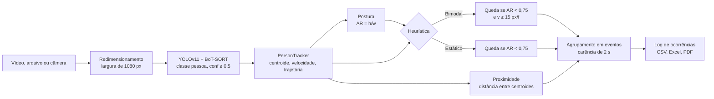

# Sistema de Análise e Detecção de Quedas

**Aplicação de Visão Computacional para Prevenção de Acidentes em Ambientes Escolares: Uma Prova de Conceito (PoC)**

Universidade Federal do Piauí (UFPI) · Centro de Educação Aberta e a Distância (CEAD) · Curso Superior de Tecnologia em Gestão de Dados (CSTGD)

[](https://github.com/cleristoncramos/Analise-de-Deteccao-de-Quedas/actions/workflows/testes.yml)


[](https://deteccao-quedas.streamlit.app)

> **Resumo.** Quedas estão entre as principais causas de atendimentos de emergência envolvendo crianças em ambiente escolar, e a supervisão humana contínua é limitada por pontos cegos, grupos numerosos e fadiga. Este trabalho apresenta uma prova de conceito de monitoramento por vídeo que combina o detector de objetos YOLOv11 (classe *pessoa*) com uma **heurística bimodal**: a postura é inferida pela razão de aspecto da caixa delimitadora, e a queda só é confirmada quando a chegada à postura deitada ocorre com velocidade do centroide acima de um limiar. A avaliação, feita em nível de evento (*event-level evaluation*) sobre 79 eventos de três bases complementares (cenário escolar simulado, UR Fall Detection Dataset e vídeos de domínio público), mostra que o limitador cinemático reduz os falsos positivos de 22 para entre 6 e 9, conforme o modelo, e alcança precisão de 100% no UR Fall. O YOLOv11s apresentou o melhor equilíbrio global (acurácia de 70,8% e F1 de 0,656). O repositório reúne o pipeline de inferência, uma interface web para demonstração e análise dos resultados, a linha de comando usada nos experimentos e os testes automatizados.

---

## Autoria

| Função | Nome |
|---|---|
| Autor | Brendo Alves Soares |
| Orientador | Wener Borges de Sampaio |
| Orientador | Martony Demes da Silva |
| Instituição | Universidade Federal do Piauí (UFPI), Centro de Educação Aberta e a Distância (CEAD) |
| Curso | Curso Superior de Tecnologia em Gestão de Dados (CSTGD) |
| Natureza | Trabalho de Conclusão de Curso, em formato de artigo científico (modelo SBC) |

---

## Sumário

1. [Introdução e motivação](#1-introdução-e-motivação)
2. [Objetivos](#2-objetivos)
3. [Fundamentação técnica](#3-fundamentação-técnica)
4. [Metodologia](#4-metodologia)
5. [Resultados](#5-resultados)
6. [Discussão e limitações](#6-discussão-e-limitações)
7. [Arquitetura do software](#7-arquitetura-do-software)
8. [Instalação e execução](#8-instalação-e-execução)
9. [Uso da aplicação web](#9-uso-da-aplicação-web)
10. [Câmera do navegador e servidor TURN](#10-câmera-do-navegador-e-servidor-turn)
11. [Testes e qualidade](#11-testes-e-qualidade)
12. [Reprodutibilidade](#12-reprodutibilidade)
13. [Trabalhos futuros](#13-trabalhos-futuros)
14. [Como citar](#14-como-citar)
15. [Licença e uso](#15-licença-e-uso)
16. [Agradecimentos](#16-agradecimentos)

---

## 1. Introdução e motivação

O ambiente escolar concentra um número elevado de acidentes com crianças, e as quedas respondem por quase 60% dos atendimentos de emergência nesse contexto, conforme o levantamento que motivou o trabalho. A supervisão realizada por professores e monitores é indispensável, mas sujeita a limitações estruturais: pontos cegos nas salas e pátios, muitos alunos sob a responsabilidade de poucos adultos e a fadiga ao longo do dia.

Sistemas de visão computacional podem atuar como uma **camada adicional de monitoramento**, sinalizando em tempo real situações que exigem atenção imediata. O principal obstáculo prático, porém, é a **fadiga de alarme**: um detector que confunde quem se senta ou se deita deliberadamente com uma queda gera tantos falsos positivos que acaba ignorado. Este trabalho investiga se uma regra simples, baseada na geometria da caixa delimitadora e na cinemática do seu centroide, é capaz de reduzir esses alarmes falsos sem recorrer a modelos de pose ou a treinamento específico.

Por restrições legais e éticas relacionadas a imagens de menores (LGPD e Estatuto da Criança e do Adolescente), a validação não utilizou gravações reais de alunos. Em seu lugar, foram combinadas três bases complementares, descritas na [seção 4.6](#46-bases-de-dados).

## 2. Objetivos

### 2.1 Objetivo geral

Desenvolver e avaliar uma prova de conceito de detecção automática de quedas em vídeo para ambientes escolares, capaz de distinguir quedas reais de mudanças voluntárias de postura.

### 2.2 Objetivos específicos

- Detectar e rastrear pessoas em vídeo com as cinco variantes pré-treinadas do YOLOv11 (n, s, m, l e x), sem treinamento adicional.
- Inferir a postura de cada pessoa a partir da razão de aspecto da caixa delimitadora.
- Estimar a velocidade do centroide de cada pessoa rastreada, normalizada pela taxa de quadros do vídeo.
- Confirmar quedas pela conjunção de postura deitada e velocidade elevada (heurística bimodal) e comparar o resultado com a linha de base apenas postural.
- Avaliar o desempenho em nível de evento em três bases de dados e comparar as variantes do modelo.
- Disponibilizar uma interface de demonstração, auditoria e exportação de relatórios.

## 3. Fundamentação técnica

### 3.1 Detecção de pessoas com YOLOv11

O YOLOv11 (Ultralytics) é um detector de objetos de estágio único, que prediz caixas delimitadoras e classes em uma única passagem pela rede. O sistema utiliza os pesos pré-treinados no conjunto COCO e mantém apenas as detecções da **classe 0 (pessoa)**, com confiança mínima padrão de **0,5**. As cinco variantes avaliadas diferem em profundidade e largura da rede, o que permite analisar o compromisso entre custo computacional e estabilidade das caixas.

### 3.2 Rastreamento multiobjeto

Para que a velocidade seja calculada sempre sobre a mesma pessoa, cada detecção recebe um identificador persistente entre quadros. O sistema usa o rastreamento nativo da Ultralytics (`model.track(persist=True)`), cujo rastreador padrão é o **BoT-SORT**, baseado em filtro de Kalman e na associação por sobreposição de caixas. O estado do rastreador é reiniciado a cada novo vídeo (`reiniciar_rastreamento`). Detecções que ainda não receberam ID ficam sem identidade, em vez de receber um número que poderia colidir com o de outra pessoa.

### 3.3 Razão de aspecto (geometria postural)

Para uma caixa de largura *w* e altura *h*, a razão de aspecto é

$$AR = \frac{h}{w}$$

| Postura inferida | Intervalo |
|---|---|
| Deitado | AR < 0,75 |
| Sentado/Agachado | 0,75 ≤ AR ≤ 1,20 |
| Em pé | AR > 1,20 |

A geometria isolada não distingue uma queda de alguém que se deita de propósito, o que motiva o segundo ramo da heurística.

### 3.4 Velocidade do centroide (cinemática)

O centroide da caixa é $C = \left(\frac{x_1 + x_2}{2}, \frac{y_1 + y_2}{2}\right)$. Para uma pessoa com ID *i*, a velocidade é calculada em relação à última observação do mesmo ID:

$$v_i = \frac{\lVert C_{i,t} - C_{i,t'} \rVert_2}{t - t'} \cdot \frac{FPS}{30}$$

em que $t - t'$ é o número de quadros entre as duas observações. Dividir pelo intervalo evita saltos artificiais de velocidade quando a pessoa some atrás de um obstáculo e reaparece; o fator $FPS/30$ expressa a velocidade sempre em **pixels por quadro na referência de 30 FPS**, de modo que o mesmo limiar tenha o mesmo significado em vídeos de 25, 30 ou 60 FPS. IDs ausentes por mais de 30 quadros são descartados.

| Classe de movimento | Intervalo |
|---|---|
| Mexendo-se pouco | v < 1,0 px/f |
| Andando | 1,0 ≤ v < 30,0 px/f |
| Correndo | v ≥ 30,0 px/f |

## 4. Metodologia

### 4.1 Pipeline de processamento



Todo quadro é redimensionado para **1080 px de largura** antes da inferência (padrão da metodologia), o que reduz a disparidade de escala entre vídeos de resoluções diferentes. Na interface é possível reduzir para 720 ou 480 px para acelerar a execução em CPU. Uma única inferência por quadro alimenta os dois ramos heurísticos, o que torna a comparação entre eles justa.

### 4.2 Heurística de confirmação de queda

$$\text{Queda} \iff (AR < \text{0,75}) \land (v \ge \text{15,0 px/f})$$

| Modo | Regra | Papel no estudo |
|---|---|---|
| **Bimodal** (com velocidade) | postura deitada **e** $v \ge 15$ px/f | proposta do trabalho |
| **Estático** (sem velocidade) | apenas postura deitada | linha de base |
| **Comparativo A/B** | executa os dois modos sobre a mesma inferência | demonstração lado a lado |

### 4.3 Alerta de proximidade

Além das quedas, o sistema sinaliza pares de pessoas cujos centroides estejam a menos de **60 px** um do outro, como indicador de aglomeração ou de contato físico.

### 4.4 Agrupamento de ocorrências em eventos

Uma mesma queda satisfaz a heurística em vários quadros consecutivos, e uma dupla próxima permanece próxima por segundos. Para que o registro corresponda a eventos e não a quadros, cada ocorrência recebe uma chave (`("QUEDA", id)` ou `("PROXIMIDADE", (id_a, id_b))`) e só gera um novo registro após **2 segundos** sem ser observada (60 quadros a 30 FPS). Ocorrências sem ID estável são registradas individualmente. O comportamento quadro a quadro dos scripts originais continua disponível com `--POR-FRAME`.

### 4.5 Avaliação em nível de evento

A avaliação adota o paradigma *event-level evaluation*: cada episódio contínuo do vídeo (uma queda ou uma atividade sem queda) é uma unidade de análise, classificada como verdadeiro positivo (TP), falso positivo (FP), verdadeiro negativo (TN) ou falso negativo (FN). As métricas são

$$\text{Acurácia} = \frac{TP + TN}{TP + TN + FP + FN} \qquad \text{Precisão} = \frac{TP}{TP + FP} \qquad \text{Revocação} = \frac{TP}{TP + FN} \qquad F_1 = \frac{2 \cdot P \cdot R}{P + R}$$

### 4.6 Bases de dados

| Base | Eventos (por modelo) | Descrição |
|---|---:|---|
| Simulado (escola) | 16 | gravado em sala de aula com câmeras em posição de monitoramento; movimentação em grupo, oclusões, ações voluntárias e quedas ensaiadas |
| UR Fall Detection Dataset | 60 | benchmark da literatura com 30 quedas e 30 atividades de vida diária (ADL) |
| Vídeos de domínio público | 3 | cenas reais usadas como teste de estresse (ruído, iluminação variável e quedas na direção da câmera, no eixo Z) |
| **Total** | **79** | |

Os valores numéricos de todas as tabelas estão em [`data/tcc_benchmark_data.json`](data/tcc_benchmark_data.json), que é a fonte usada pela interface e pelos testes.

## 5. Resultados

### 5.1 Desempenho global (79 eventos)

| Cenário | Modelo | TN | FP | FN | TP | Acurácia | Precisão | Revocação | F1 |
|---|---|---:|---:|---:|---:|---:|---:|---:|---:|
| Com Velocidade | YOLOv11n | 34 | 7 | 23 | 15 | 0,620 | 0,681 | 0,394 | 0,500 |
| Com Velocidade | **YOLOv11s** | 34 | 7 | 16 | 22 | **0,708** | 0,758 | **0,578** | **0,656** |
| Com Velocidade | YOLOv11m | 35 | **6** | 18 | 20 | 0,696 | **0,769** | 0,526 | 0,625 |
| Com Velocidade | YOLOv11l | 35 | **6** | 21 | 17 | 0,658 | 0,739 | 0,447 | 0,557 |
| Com Velocidade | YOLOv11x | 33 | 9 | 20 | 18 | 0,637 | 0,666 | 0,473 | 0,553 |
| Sem Velocidade | YOLOv11m\* | 31 | 22 | 12 | 26 | 0,626 | 0,541 | 0,684 | 0,604 |

\* A linha de base sem velocidade foi avaliada com o YOLOv11m.

### 5.2 Dataset simulado (escola)

| Cenário | Modelo | TN | FP | FN | TP | Acurácia | Precisão | Revocação | F1 |
|---|---|---:|---:|---:|---:|---:|---:|---:|---:|
| Com Velocidade | YOLOv11n | 2 | 7 | 4 | 3 | 0,312 | 0,300 | 0,428 | 0,352 |
| Com Velocidade | YOLOv11s | 2 | 7 | 3 | 4 | 0,375 | 0,363 | 0,571 | 0,444 |
| Com Velocidade | YOLOv11m | 3 | 6 | 4 | 3 | 0,375 | 0,333 | 0,428 | 0,375 |
| Com Velocidade | YOLOv11l | 3 | 6 | 5 | 2 | 0,312 | 0,250 | 0,285 | 0,266 |
| Com Velocidade | YOLOv11x | 1 | 9 | 4 | 3 | 0,235 | 0,250 | 0,428 | 0,315 |
| Sem Velocidade | YOLOv11m\* | 2 | 16 | 2 | 5 | 0,280 | 0,238 | 0,714 | 0,357 |

### 5.3 UR Fall Detection Dataset

| Cenário | Modelo | TN | FP | FN | TP | Acurácia | Precisão | Revocação | F1 |
|---|---|---:|---:|---:|---:|---:|---:|---:|---:|
| Com Velocidade | YOLOv11n | 30 | 0 | 18 | 12 | 0,700 | 1,000 | 0,400 | 0,571 |
| Com Velocidade | YOLOv11s | 30 | 0 | 12 | 18 | 0,800 | 1,000 | 0,600 | 0,750 |
| Com Velocidade | YOLOv11m | 30 | 0 | 13 | 17 | 0,783 | 1,000 | 0,566 | 0,723 |
| Com Velocidade | YOLOv11l | 30 | 0 | 15 | 15 | 0,750 | 1,000 | 0,500 | 0,666 |
| Com Velocidade | YOLOv11x | 30 | 0 | 15 | 15 | 0,750 | 1,000 | 0,500 | 0,666 |
| Sem Velocidade | YOLOv11m\* | 28 | 2 | 10 | 20 | 0,800 | 0,909 | 0,666 | 0,769 |

### 5.4 Vídeos de domínio público

| Cenário | Modelo | TN | FP | FN | TP | Acurácia | Precisão | Revocação | F1 |
|---|---|---:|---:|---:|---:|---:|---:|---:|---:|
| Com Velocidade | Todos (v11n–x) | 2 | 0 | 1 | 0 | 0,666 | 0,000 | 0,000 | 0,000 |
| Sem Velocidade | Todos (v11n–x) | 1 | 4 | 0 | 1 | 0,333 | 0,200 | 1,000 | 0,333 |

### 5.5 Síntese

- **Redução de falsos positivos.** No conjunto global, a heurística apenas postural produziu 22 falsos positivos; com o limitador de velocidade, os modelos ficaram entre 6 (YOLOv11m e YOLOv11l) e 9 (YOLOv11x). No UR Fall, todos os modelos com velocidade atingiram **precisão de 100%**.
- **Melhor equilíbrio.** O YOLOv11s obteve a maior acurácia (70,8%), a maior revocação entre os modelos com velocidade (57,8%) e o maior F1 (0,656), com ganho de 8,2 pontos percentuais de acurácia e de 21,7 p.p. de precisão em relação à linha de base.
- **Custo da filtragem.** A linha de base tem revocação maior (68,4%), pois aceita qualquer postura deitada; o limitador troca parte da revocação por precisão, o que é desejável para evitar a fadiga de alarme.

## 6. Discussão e limitações

**Sobreajuste espacial dos modelos maiores.** As variantes *Large* e *Extra Large* não superaram o YOLOv11s. Sob oclusão, suas caixas oscilaram de forma contínua, produzindo vetores de velocidade espúrios que degradaram a precisão. O YOLOv11s mostrou-se a arquitetura mais estável para a aplicação.

**Gargalo do eixo Z.** Quedas na direção da câmera produzem pouco deslocamento em pixels no plano da imagem, e a velocidade 2D fica abaixo do limiar mesmo em quedas reais. Isso explica a revocação nula do ramo com velocidade nos vídeos de domínio público. A velocidade também depende da distância da pessoa à câmera: o mesmo movimento gera mais pixels por quadro perto da lente do que ao fundo da cena.

**Limiares fixos em pixels.** Os limiares de 0,75 (AR) e 15 px/f (velocidade) foram definidos para vídeos processados com 1080 px de largura. Em outras resoluções ou enquadramentos, a calibração deve ser revista, o que pode ser feito pela interface.

**Bases de dados.** Por razões éticas, não foram usadas gravações reais de alunos; o cenário escolar é simulado e a base de vídeos públicos é pequena (3 eventos), o que limita a generalização dos resultados.

**Observações sobre os dados.** Dois pontos das tabelas ainda precisam ser conferidos na contagem original. Eles ficam registrados no campo `metadados.pendencias` de `data/tcc_benchmark_data.json` e não são exibidos na interface:

- **YOLOv11x (Com Velocidade):** soma 80 eventos. Na Tabela 1 tem 17 eventos simulados (10 negativos), enquanto os demais modelos têm 16 (9 negativos).
- **Sem Velocidade (YOLOv11m\*):** soma 91 eventos (53 negativos, contra 41 nos demais). Os falsos alarmes parecem ter sido contados como eventos novos; para comparar a acurácia entre cenários, os dois devem usar o mesmo conjunto de eventos reais.

## 7. Arquitetura do software

### 7.1 Estrutura de diretórios

```text
.
├── app.py                      # Interface web (Streamlit): página inicial, informações acadêmicas e sistema
├── cli.py                      # Linha de comando usada nos experimentos (mesmo pipeline da interface)
├── core/                       # Núcleo do pipeline, sem dependência do Streamlit
│   ├── yolo_engine.py          # Carregamento dos pesos, inferência YOLOv11 + rastreamento, filtro da classe pessoa
│   ├── tracker.py              # PersonTracker: centroides, velocidade normalizada por FPS, trajetórias
│   ├── heuristics.py           # Postura (AR), classe de movimento, confirmação de queda, proximidade, v normalizada
│   ├── video_processor.py      # Redimensionamento, desenho das anotações e geração dos eventos por quadro
│   ├── eventos.py              # AgrupadorEventos: agrupa ocorrências por pessoa/dupla com período de carência
│   └── ice_servers.py          # Configuração STUN/TURN da câmera do navegador a partir dos Secrets
├── pages_modules/              # Páginas da interface
│   ├── pagina_inicial.py       # Página inicial (apresentação, vídeo de demonstração, tutorial)
│   ├── informacoes_academicas.py
│   ├── visao_geral.py          # Resumo do trabalho, heurística e bases de dados
│   ├── estudio_inferencia.py   # Execução sobre vídeo, amostra ou câmera, nos modos Bimodal, Estático e A/B
│   ├── camera_navegador.py     # Processamento ao vivo da câmera do navegador (WebRTC)
│   ├── dashboard_metricas.py   # Tabelas 1 a 4, matrizes de confusão e gráficos comparativos
│   ├── auditoria_logs.py       # Log de ocorrências e exportação em CSV, Excel e PDF
│   ├── laboratorio_experimental.py  # Simulações do eixo Z e da velocidade normalizada
│   └── navegacao.py            # Controle da tela ativa (página inicial, acadêmica ou sistema)
├── components/                 # Gráficos Plotly e cartões reutilizáveis
├── data/tcc_benchmark_data.json  # Métricas do artigo (fonte única para interface e testes)
├── assets/                     # Estilos, logotipos institucionais e vídeo de demonstração
├── tools/gerar_video_demo.py   # Gera o vídeo de demonstração da página inicial
├── tests/                      # Testes automatizados (pytest)
├── legado/                     # Primeira versão (Google Colab) e scripts originais dos experimentos
├── Template_SBC/               # Modelo de artigo da Sociedade Brasileira de Computação
├── .streamlit/                 # Tema da interface e modelo de Secrets
├── requirements.txt            # Dependências da aplicação
├── requirements-dev.txt        # Dependências dos testes e do lint
└── packages.txt                # Bibliotecas de sistema para o Streamlit Community Cloud
```

### 7.2 Decisões de projeto

- **Pipeline único.** A interface web e a linha de comando usam as mesmas funções de `core/`, o que garante que a demonstração reproduza o comportamento dos experimentos.
- **Estado por sessão.** O modelo é carregado uma vez por sessão do usuário, e não compartilhado entre sessões, porque o rastreador da Ultralytics guarda estado dentro do objeto do modelo; compartilhá-lo misturaria IDs de usuários diferentes.
- **Núcleo testável.** `core/__init__.py` não importa o motor YOLO nem o OpenCV, para que heurísticas, rastreador e agrupamento possam ser testados sem PyTorch.
- **Código legado preservado.** Os scripts originais dos modelos "Sem Velocidade" e "Com Velocidade" estão em `legado/` como registro dos experimentos do artigo.

## 8. Instalação e execução

### 8.1 Requisitos

- Python 3.11 ou superior (o Streamlit Community Cloud executa a aplicação em Python 3.14).
- Para execução em GPU, PyTorch com suporte a CUDA; sem GPU, a inferência roda em CPU.
- No Linux, as bibliotecas de sistema `libgl1` e `libglib2.0-0`, exigidas pelo OpenCV (listadas em `packages.txt`).

### 8.2 Ambiente

```bash
python -m venv .venv
# Windows (PowerShell)
.\.venv\Scripts\Activate.ps1
# Linux / macOS
source .venv/bin/activate

pip install -r requirements.txt
```

Os pesos (`yolo11n.pt` … `yolo11x.pt`) são procurados em `modelos/` e na raiz do projeto; se não existirem, a Ultralytics baixa os pesos oficiais automaticamente na primeira execução.

### 8.3 Interface web

```bash
streamlit run app.py
```

A versão publicada está em [deteccao-quedas.streamlit.app](https://deteccao-quedas.streamlit.app).

### 8.4 Linha de comando

```bash
# Proposta: postura + velocidade
python cli.py --SOURCE videos/queda_01.mp4 --MODEL yolo11s.pt --MODO com
# Linha de base: apenas postura
python cli.py --SOURCE videos/queda_01.mp4 --MODEL yolo11s.pt --MODO sem
# Webcam local
python cli.py --SOURCE 0 --MODEL yolo11n.pt
```

| Argumento | Padrão | Descrição |
|---|---|---|
| `--SOURCE` | obrigatório | caminho do vídeo ou `0` para a webcam |
| `--MODEL` | `yolo11s.pt` | arquivo de pesos (procurado em `modelos/` e na raiz) |
| `--MODO` | `com` | `com` (bimodal, proposta) ou `sem` (estático, linha de base) |
| `--CONF` | `0.5` | confiança mínima do YOLO |
| `--LIMIAR-AR` | `0.75` | razão de aspecto abaixo da qual a pessoa é considerada deitada |
| `--LIMIAR-VEL` | `15.0` | velocidade mínima (px/f) para confirmar a queda |
| `--DIST-PROX` | `60.0` | distância (px) entre centroides para o alerta de proximidade |
| `--LARGURA` | `1080` | largura de processamento em pixels |
| `--SEM-CORRECAO-FPS` | desligado | usa px/f sem converter para a referência de 30 FPS |
| `--POR-FRAME` | desligado | registra todo quadro que satisfaz a heurística, sem agrupar em eventos |
| `--CARENCIA` | `2.0` | segundos sem ocorrência para que a mesma pessoa ou dupla gere um novo evento |
| `--SEM-JANELA` | desligado | processa sem abrir a janela de visualização (mais rápido em lote) |

Os relatórios CSV são gravados em `relatorios/<vídeo>/<modelo>/`.

Execução em lote de todos os modelos e modos (PowerShell):

```powershell
$modelos = @("yolo11n.pt", "yolo11s.pt", "yolo11m.pt", "yolo11l.pt", "yolo11x.pt")
foreach ($video in Get-ChildItem "videos\*.mp4") {
    foreach ($modelo in $modelos) {
        foreach ($modo in @("com", "sem")) {
            python cli.py --SOURCE $video.FullName --MODEL $modelo --MODO $modo --SEM-JANELA
        }
    }
}
```

Equivalente em bash:

```bash
for video in videos/*.mp4; do
  for modelo in yolo11n.pt yolo11s.pt yolo11m.pt yolo11l.pt yolo11x.pt; do
    for modo in com sem; do
      python cli.py --SOURCE "$video" --MODEL "$modelo" --MODO "$modo" --SEM-JANELA
    done
  done
done
```

Os scripts originais continuam em `legado/` e devem ser executados de dentro da própria pasta, por exemplo:

```bash
cd legado/modelo_com_velocidade
python main.py --SOURCE ../../videos/x.mp4 --MODEL ../../modelos/yolo11s.pt
```

## 9. Uso da aplicação web

| Tela | Conteúdo |
|---|---|
| **Página inicial** | apresentação do projeto, vídeo de demonstração da heurística, indicadores do artigo, tutorial em quatro etapas e primeiros passos |
| **Informações Acadêmicas** | identificação do trabalho, instituição, curso, autoria, orientação, tecnologias e bases de dados |
| **Visão Geral e Artigo** | contexto, heurística bimodal com fórmulas, bases de dados e principais conclusões |
| **Estúdio de Inferência** | execução sobre upload, amostra da pasta `videos/`, câmera do navegador ou webcam local; modos Bimodal, Estático e Comparativo A/B; calibração de confiança, limiares de AR, velocidade e proximidade, resolução, normalização por FPS e carência de eventos |
| **Dashboard Científico** | Tabelas 1 a 4, explorador de matrizes de confusão, gráfico de radar por modelo e comparação de falsos positivos |
| **Auditoria e Logs** | tabela de ocorrências da sessão, com filtros e exportação em CSV, Excel e relatório técnico em PDF |
| **Laboratório Experimental** | simulador da perda de escala no eixo Z e da velocidade normalizada $v_{norm} = \frac{v}{\sqrt{w \cdot h}} \times 100$, com limiar de 12%, e discussão da transição para estimativa de pose |

O ícone da casa na barra lateral retorna à página inicial.

## 10. Câmera do navegador e servidor TURN

A opção **Câmera do Navegador** do Estúdio de Inferência usa WebRTC (`streamlit-webrtc`): a imagem vem da câmera de quem acessa a página, e cada quadro é processado no servidor pelo mesmo pipeline. Localmente basta o STUN público, mas no Streamlit Community Cloud o servidor fica atrás de NAT e a conexão de vídeo precisa de um servidor TURN; sem ele, a câmera fica em "Connection is taking longer than expected" com a imagem preta.

1. Crie uma conta gratuita em [metered.ca](https://www.metered.ca/), abra **TURN Server** e anote o nome do app (o subdomínio de `<app>.metered.live`) e a **API key**.
2. No Streamlit Cloud, abra **Manage app > Settings > Secrets** e cole:

   ```toml
   [turn]
   metered_app = "nome-do-app"
   metered_api_key = "sua-api-key"
   ```

3. Salve e reinicie o app. A legenda abaixo da opção passa a indicar que a conexão usa TURN.

Também é possível usar Twilio ou uma lista fixa de servidores; o modelo com todos os campos está em [`.streamlit/secrets.toml.example`](.streamlit/secrets.toml.example). Para testar localmente, copie esse arquivo para `.streamlit/secrets.toml`, que não é versionado. Se a busca das credenciais falhar, a aplicação continua funcionando apenas com STUN e exibe um aviso.

## 11. Testes e qualidade

```bash
pip install -r requirements-dev.txt
pytest
ruff check .
```

| Arquivo | O que verifica |
|---|---|
| `tests/test_heuristics.py` | classificação de postura e de movimento, confirmação de queda nos dois modos, proximidade e velocidade normalizada |
| `tests/test_tracker.py` | cálculo da velocidade, robustez a oclusões, correção por FPS, descarte de IDs ausentes e detecções sem ID |
| `tests/test_eventos.py` | agrupamento de ocorrências em eventos e chaves por pessoa ou dupla |
| `tests/test_video_processor.py` | redimensionamento com proporção, eventos com IDs e disparo no modo estático |
| `tests/test_benchmark_data.py` | consistência das métricas publicadas com as matrizes de confusão e da Tabela 4 com a soma das Tabelas 1 a 3 |
| `tests/test_ice_servers.py` | montagem da configuração STUN/TURN a partir de Secrets simulados |

O workflow [`.github/workflows/testes.yml`](.github/workflows/testes.yml) executa `ruff check .` e `pytest -q` em Python 3.11 a cada envio à branch `main` e a cada pull request.

## 12. Reprodutibilidade

- **Pesos.** Foram utilizados os pesos oficiais pré-treinados do YOLOv11 (n, s, m, l e x), sem ajuste fino.
- **Parâmetros.** Os valores padrão da interface e da linha de comando são os da metodologia: largura de 1080 px, confiança 0,5, AR < 0,75, v ≥ 15 px/f na referência de 30 FPS, proximidade de 60 px e carência de 2 s.
- **Métricas.** Os números do artigo estão em `data/tcc_benchmark_data.json`, e o teste `test_benchmark_data.py` recalcula acurácia, precisão, revocação e F1 a partir das matrizes de confusão.
- **Vídeos.** Os vídeos de avaliação não são versionados (`*.mp4` está no `.gitignore`). Para reproduzir os experimentos, coloque-os em `videos/` e use a execução em lote da [seção 8.4](#84-linha-de-comando).
- **Vídeo de demonstração.** A animação da página inicial é sintética, gerada por `python tools/gerar_video_demo.py`; ela ilustra a heurística e não faz parte das bases de avaliação.

## 13. Trabalhos futuros

- **Normalização de escala.** Dividir a velocidade pela dimensão da caixa ($v_{norm}$), tornando o limiar independente da distância à câmera, conforme prototipado no Laboratório Experimental.
- **Estimativa de pose.** Substituir a razão de aspecto por pontos-chave do corpo (YOLO11-Pose), o que permite medir a inclinação do tronco e reduz a dependência da geometria da caixa, especialmente em quedas no eixo Z.
- **Bases maiores e reais.** Ampliar a base de vídeos públicos e, com as devidas autorizações éticas, validar o sistema em ambiente escolar real.
- **Uniformização da avaliação.** Resolver as pendências de contagem descritas na [seção 6](#6-discussão-e-limitações), para que os dois cenários sejam comparados sobre o mesmo conjunto de eventos.

## 14. Como citar

Formato ABNT:

> SOARES, Brendo Alves. **Aplicação de Visão Computacional para Prevenção de Acidentes em Ambientes Escolares**: uma Prova de Conceito (PoC). Orientadores: Wener Borges de Sampaio e Martony Demes da Silva. Trabalho de Conclusão de Curso (Curso Superior de Tecnologia em Gestão de Dados) – Centro de Educação Aberta e a Distância, Universidade Federal do Piauí, Teresina, [s.d.].

## 15. Licença e uso

O repositório não possui arquivo de licença. Trata-se de um trabalho acadêmico desenvolvido como Trabalho de Conclusão de Curso; o reuso do código ou dos resultados deve citar o trabalho conforme a [seção 14](#14-como-citar). Os logotipos da UFPI e do CEAD pertencem às respectivas instituições e são usados apenas para identificar o trabalho; suas fontes estão registradas em [`assets/institucional/FONTES.md`](assets/institucional/FONTES.md). O UR Fall Detection Dataset e os pesos do YOLOv11 seguem as licenças de seus respectivos autores.

## 16. Agradecimentos

À Universidade Federal do Piauí e ao Centro de Educação Aberta e a Distância, pela formação e pelo apoio ao desenvolvimento deste trabalho; aos orientadores Wener Borges de Sampaio e Martony Demes da Silva, pela orientação ao longo da pesquisa; e aos mantenedores da Ultralytics e do UR Fall Detection Dataset, cujos recursos abertos tornaram esta prova de conceito possível.
